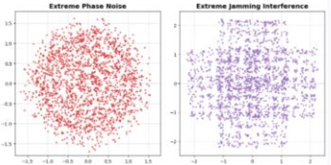

# Traditional CNN meets VLM multimodal big model! Radio frequency constellation map intelligent diagnosis, who is the best solution in real scene? [Attached Python code]

Traditional CNNs meet multimodal big models! Smart diagnosis of radio frequency constellation diagrams, who is the optimal solution in real scenarios? Original research on AI for radio frequency signals | Comparing labels from signal simulation, model training to generalization capabilities: #Wireless Communication #Radio Frequency Artificial Intelligence #Signal Recognition #Multimodal Big Models #Deep Learning Deployment
Introduction to the opening remarks in the field of physical layer detection of wireless communication, constellation diagrams are the most intuitive carriers for interpreting the quality of radio frequency signals. Different modulation methods, phase noise, IQ imbalance, amplitude distortion, interference, and SNR directly change the distribution pattern of constellation points.
For a long time, industry has mainly used convolutional neural networks to classify constellation diagrams and regression tasks on damage severity. However, with the rapid popularization of multimodal vision big models, a core question has emerged: will the VLM visual language model, equipped with text and image understanding capabilities, completely overwhelm traditional CNNs and become a new scheme for radio frequency signal diagnosis?
This study builds a complete simulation dataset, respectively trains two sets of solutions: lightweight multitask CNN and Qwen2-VL 2B visual big model based on LoRA fine-tuning. The experiment compares recognition accuracy, robustness to low SNR, generalization ability to unknown damages, inference speed, and hardware cost from five dimensions. The experimental conclusion breaks many people's inherent perception of "universality" of big models.
1. First understand the underlying experiment: A full-in-house radio frequency signal simulation system To fairly compare model performance, the core premise is to have a unified, controllable, and comprehensive dataset covering all scenarios. This experiment fully automates the signal generation link, avoiding the pain points of single scene types in public datasets and missing damage types.
1.16 Class mainstream modulation signal full coverage simulation library is built-in with the current satellite and ground communication mainstream modulation systems, including five major series of 16 types of modulation waveforms: 4/8-ASK, BPSK, QPSK, 4/16/64-HQAM, 16/32/64/128/256-QAM, 16/32/64/128-APSK. Each modulation waveform completes normalization power processing to ensure the unified energy baseline of signals, eliminating the interference of power differences on recognition results.
2. Mathematical modeling of four types of channel damage, distinguishing between known / unknown scenarios where real RF signal transmission processes are subject to various hardware defects and channel interferences. This time, we have established a damage model with adjustable severity for four types:
1  
Phase noise: Simulates random phase shifts based on the von Mises distribution, controlling the strength of noise with a distribution concentration coefficient.
2  
IQ Amplitude Phase Distortion: Defines two parameters for damage, gain difference and phase offset, to simulate the non-ideal characteristics of hardware in transceivers.
3  
Amplitude saturation distortion: Using the Rapp power amplifier nonlinear model, simulates the compression of constellation points brought about by the saturation of power amplifiers.
4  
Narrowband interference: Randomly generate superimposed single-frequency interference pulses, controlling the duty cycle of the interference to simulate different levels of blocking interference.
The severity of damage is divided into five categories: none (no damage), low (mild), medium (moderate), high (severe), and extreme (extreme). The training / validation set only uses three levels of damage (known parameters); the test generalization set adds two levels of training from unseen intermediate categories (OOD unknown parameters) to specifically validate the model's interpolation inference capabilities.
3. Multi-gradient SNR Segmentation, Building High and Low Noise Testing Environments
The SNR values are divided into known intervals: 0/10/20/30dB; unknown interpolation intervals: 5/15/25dB. At the same time, the SNR is segmented into low / medium / high levels of semantic tags to adapt the text output logic of visual language models.
4. High-speed Constellation Image Compression Scheme, Solving the problem of massive data storage
Traditional matplotlib drawing one by one is slow and consumes a large amount of storage space. This self-developed pixel-by-pixel algorithm maps complex constellation coordinates directly to a 384×384 grayscale canvas. Through 3×3 convolutional expansion, it magnifies the constellation points and restores the visualization effect. Key optimization: The 384×384 grayscale image is packed in binary bits, reducing the storage volume of each image by 87.5%. Large datasets can be mapped to local memory for reading, significantly reducing training memory and hard drive usage, and adapting to general server training.
5. Data Set Division Logic (Training / Validation / Generalization Testing Three Separate)
1. Training set: Full traversal of all modulations, known SNR, and known three damage combinations, sufficient sample fitting basic features;
2. Validation set: Independent sampling with the same known parameter distribution, used for early stopping and optimal model weight saving;
3. Generalization test set: Force each sample to include at least one unknown parameter (unknown SNR / mild / severe damage), up to four unknown parameters, simulate signal conditions never seen in engineering, specifically testing the model's extrapolation ability.
II. Complete Design Ideas for Two Sets of Comparative Models
A: Lightweight Multi-task CNN (Industrial Landing Baseline Model)
The overall architecture is divided into shared feature extraction main body + multiple branch independent output heads, belonging to an end-side friendly lightweight network, with a total trainable parameters of only 9.5 million.
Feature Backbone: Four-layer convolution + BN+ReLU + max pooling stack, gradually extracting spatial features such as constellation map edges, clustered distribution, and distorted textures. The endpoint adaptive average pooling uniformly resizes the features to avoid size differences caused by constellation map scaling;
2  
Classification branch (cross-entropy loss)  
Modulation recognition head: outputs 16-dimensional categories, distinguishing 16 types of modulation methods;  
SNR range identification head: outputs 5 classes of SNR levels;  
3  
Regression branch (Huber robust loss) phase noise, IQ imbalance, amplitude distortion, interference damage with four types of damages using independent regression heads, outputting continuous numerical values from 0 to 4 corresponding to five severity levels of damage. During training, manually weight loss weights to prioritize improving modulation recognition accuracy (modulation loss weight three times that of other tasks), aligning with the core requirement in engineering "identify modulation type first". A supporting early stopping mechanism is implemented, terminating training if there is no decrease in loss for five consecutive rounds, saving the global optimal weights.  
Solution B: Qwen2-VL-2B Visual Language Large Model (LoRA fine-tuning) selects a 2B parameter lightweight multimodal base, employing LoRA low-rank adaptation to efficiently fine-tune parameters, only fine-tuning a small number of adapter parameters, freezing most of the base weights, reducing the training computational requirements.  
1  
Training paradigm: text-image dialogue fine-tuning, inputting constellation maps + unified question scripts, outputting structured natural language answers, fully including modulation type, SNR range, and four types of damage severity text descriptions;  
2
Inference Innovation: Logit Interpolation Prediction (Addressing Discrepancies in Discrete Text Outputs of Large Models)
Traditional VLM inference can only output three categories of damage words - none, medium, extreme - seen during training. It cannot handle low or high unknown levels. This paper proposes an interpolation calculation method based on raw token probabilities: by extracting the original logits corresponding to each word token, softmax normalization is used to obtain the probability of three known damage levels. The sum of these probabilities is weighted to calculate a continuous damage estimate, which is then mapped to a five-level complete damage range from 0 to 4, achieving interpolation prediction for intermediate damage levels not seen during training.
Training Constraints: Only the assistant's answer part of the loss is calculated, and user image question text is masked to avoid model fitting irrelevant dialogue content; gradient checkpoints and BF16 mixed precision are used to optimize memory usage, supporting multi-card distributed training.
Full-Dimensional Real Test Results: Clearly visible strengths and weaknesses
1. Known scene (validation set) recognition accuracy: VLM slightly leads in training with known signal-to-noise ratio and damage level scenarios, where the visual language model's image semantic understanding advantages are prominent: it has stronger distinguishing capabilities in dense overlap areas of constellations and subtle distortion features, with higher accuracy rates in modulation identification and damage classification compared to traditional CNN. Visualization results from confusion matrices show that CNN easily makes misjudgments in complex modulations like multi-order high-order QAM and APSK, while VLM relies on fine-grained feature capture by the visual encoder to reduce misclassification errors.
2. Robustness to low signal-to-noise ratio environments: The two trends are close, with VLM having a slightly higher fault tolerance of up to 10 dB low signal-to-noise ratio strong noise scenarios. This is because the multimodal visual encoder pretraining stage learns massive natural image textures, naturally resisting noise interference and blurred images; CNN only trains on constellation diagram datasets, leading to lower generalization limits in low noise scenarios.
3. Core Conclusion: The ability to generalize unknown OOD scenarios is unknown, and CNNs comprehensively outperform large models. This is the most disruptive result of this experiment: when samples contain parameters unseen during training such as mild, severe, and intermediate signal-to-noise ratios, the recognition accuracy of VLM drops dramatically with an increase in unknown parameters, eventually converging to the same error baseline as CNNs.
Deep Cause: The visual language model overfits the fixed textual semantic boundaries in the training set, only learning the image features corresponding to "no / medium / extreme" categories, unable to independently interpolate and reason for new intermediate states; whereas CNNs return continuous numerical values directly, inherently possessing numerical interpolation capabilities, showing stronger stability against unseen damage intensity fluctuations. The MAE error curve also corroborates: under various unknown damage levels, the average error of CNNs significantly lower than that of fine-tuned VLMs, with smaller prediction deviations.
4. Efficiency and Hardware Cost: The industrial application advantages of CNN are significant. Lightweight CNN: single sample inference is only 0.32ms, and training and real-time inference can be completed on a standard T4 graphics card, making it suitable for edge embedded devices deployment;
Qwen2-VL 2B large model: single sample inference is 1.62ms, with memory usage several times that of CNNs, requiring high-performance graphics cards like A100 for operation, which is not cost-effective for low-cost real-time detection scenarios.
Fourth, Engineering Landing Scenario Selection Guide✅ Prioritize using CNN for scenarios 1  
Base station, radio frequency detection equipment, etc., real-time online identification at the edge;  
2  
Signal conditions vary greatly on-site, with a large number of middle damage states and interpolated signal-to-noise ratios not covered by training;  
3  
Hardware computing power is limited, requiring low power consumption, low memory footprint lightweight models;  
4  
Batch automation signal screening, strict requirements for inference delay.  
✅ Prioritize using LoRA fine-tuned VLM for scenario 1  
Laboratory offline deep signal analysis, needing natural language structured diagnostic reports output;  
2
The signal scenarios are fixed, with known damages and full coverage of signal-to-noise ratios, rarely encountering unknown conditions;
3  
It requires human-readable text diagnosis results, combined with backend reports and fault analysis systems;
4  
The computing power is sufficient, not limiting the inference delay, pursuing the ultimate recognition accuracy in known scenarios.
Research Summary and Future Prospects: This comparative experiment fully reproduces the entire process from signal simulation, dataset construction, dual model training, and multi-dimensional quantitative evaluation, breaking the "bigger models always outperform traditional CNN" inertia mindset:
1  
Under fixed known conditions, the visual language model relies on pre-trained visual features to achieve higher recognition accuracy and noise resistance, suitable for offline fine-grained analysis;
2  
In real engineering environments, various unlabeled and interpolated unknown signal parameters exist, making the traditional multi-task CNN continuous regression architecture more stable and reliable for industrial real-time detection;
3  
The text discrete output of VLM is a natural weakness, even with logit interpolation optimization, its extrapolation capability still cannot match that of the native regression network;
4  
Lightweight CNNs have very low computational requirements, adaptable to embedded devices and low-cost detection equipment, lowering the threshold for commercialization.
Future research directions will focus on two types of model integration solutions: using CNNs to extract real-time signal parameters, and feeding the quantified results into a multimodal big model to generate readable fault diagnosis texts, balancing inference speed with structured report output, and performance with practicality.
End of the article: Interactive: Do you prefer traditional deep learning or multimodal big models when dealing with radio frequency signal recognition? What challenges did you encounter during the engineering implementation? Feel free to discuss and exchange ideas in the comments section!

## Images

<!-- PAYMENT_BLOCK -->

## Get this dataset

- Payment link (Stripe): [Buy now](https://buy.stripe.com/3cs8yP7sY87d0vu9AB)
- Payment QR code: 

<!-- /PAYMENT_BLOCK -->
